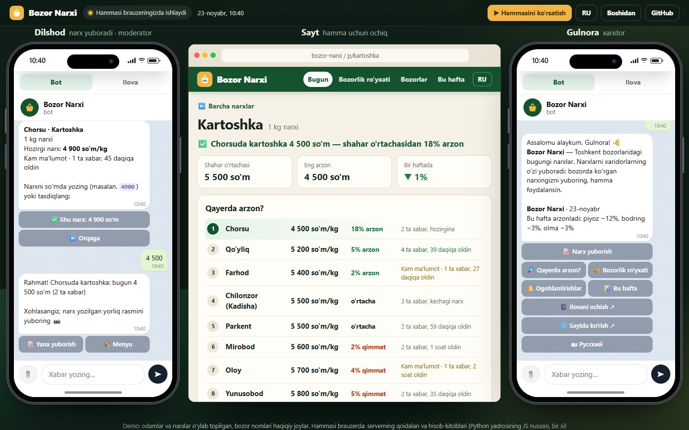
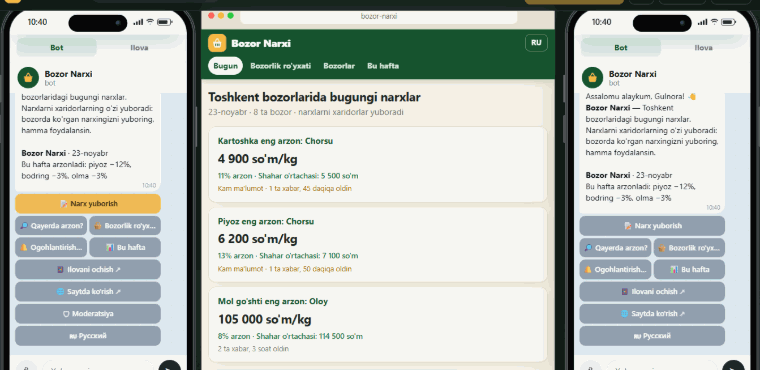
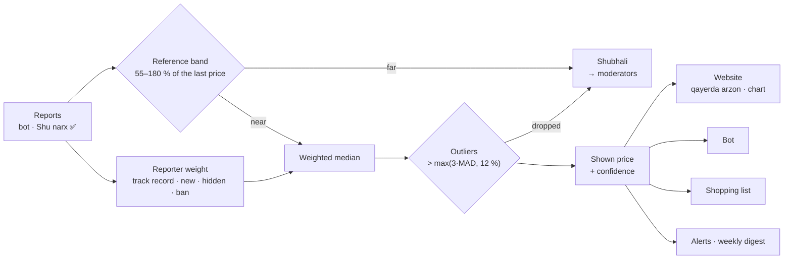

# Bozor Narxi

**English** · [O'zbekcha](README.uz.md)

[](https://github.com/xoliddev/bozor-narxi/actions/workflows/ci.yml)
[](https://xoliddev.github.io/bozor-narxi/)
[](LICENSE)


**Bazaar prices for Tashkent, sent by the people who shop there.** A Telegram bot where anyone reports the price they
see at Chorsu, Oloy, Mirobod, Yunusobod, Qo'yliq, Farhod, Chilonzor (Kadisha) or Parkent; a **public website** where
anyone sees today's prices, the price-change chart and *"qayerda arzon?"* (where is it cheapest); and a Telegram Mini
App with the shopping list and alerts.

**The core is trust.** Crowd-sourced prices only work if one troll cannot ruin them. Every bazaar-product-day gets a
**robust aggregate**: reports far from the last known price are *shubhali* (suspicious), the rest are combined by a
**weighted median**, outliers beyond `max(3·MAD, 12 %)` are dropped, and each reporter's weight comes from their track
record (new accounts weigh little; people whose numbers keep matching the consensus gain weight; numbers far off, or
hidden by a moderator, cost weight). All of it in whole numbers, so the Python server and the JavaScript in the browser
give exactly the same price. A troll's *"kartoshka 500"* is marked shubhali, does not move the price, and the troll
only sees a neutral *"Tekshiruvga yuborildi"*.

**[Live demo →](https://xoliddev.github.io/bozor-narxi/)** Dilshod's phone (he reports prices and moderates),
Gulnora's phone (a shopper) and the public website in a browser window, with a ten-step story. Everything runs in your
browser.



<p align="center"></p>

## Features

- **Sending a price (bot, buttons only):** Bozor → Mahsulot → type the price (*"4 500"*, *"4500 so'm"*, even
  *"kartoshka 4500"*) or one tap **"✅ Shu narx"** to confirm the price shown now → optionally the price tag's photo
  (kept as a Telegram file id). One report per person, bazaar, product and day — a later one replaces it; at most 40
  a day. The bot answers with what changed: *"Rahmat! Chorsuda kartoshka: bugun 4 500 so'm (2 ta xabar)"*.
- **Confidence everywhere:** *"5 ta xabar, 40 daqiqa oldin"*, *"Kam ma'lumot · 1 ta xabar"*, *"kechagi narx"*. Just
  after midnight (Tashkent time) yesterday's prices are shown as yesterday's.
- **"Qayerda arzon?"** per product: today's price at every bazaar ranked, the city median, the saving in % and so'm
  (*"Chorsuda kartoshka 4 500 so'm — shahar o'rtachasidan 18% arzon"*), the week-over-week change ▲/▼, and an SVG chart
  of 30 or 90 days: the city median line, the cheapest–dearest band, any bazaar switched on as its own line, a tooltip.
- **Bozorlik ro'yxati (shopping list):** pick products and amounts (0.5 kg steps, litres, eggs by ten) and see the total
  at every bazaar, the cheapest one and the saving against the dearest (*"Oloyda 314 700 so'm — eng qimmatidan
  26 500 so'm tejaysiz"*), the distance from you (optional location) and, honestly, which items have no price at a
  bazaar (those bazaars are listed apart, never "cheapest"). The same function in the website, the Mini App and the bot;
  the Mini App and the bot share one saved list.
- **Alerts:** *"Piyoz 6 000 so'mdan arzon bo'lsa xabar ber"* — fires once, on a price at least two reports agree on; if
  it is already true, at once. A **weekly digest** on Monday morning, once per person: *"Bu hafta arzonladi: piyoz −12%"*.
- **Moderation:** moderators get every shubhali report in the bot (where, how much, the usual price, who and their
  trust) with **🙈 Yashirish** / **⛔ Bloklash**; a Mini App tab does the same. Both recompute the affected prices at
  once; a hidden report also lowers its author's weight (*"Tez narx: ishonch 20% → 3%"*).
- **Website:** today's table with search and categories, the three everyday products' cheapest bazaar, product pages,
  bazaar pages, the shopping list and the weekly view. No sign-in to read; works at 375 px. Uzbek by default, Russian
  with one tap (the bot too).

All reporters, numbers and trolls in the seed are **invented** (realistic: a seasonal wave, a recent trend, each
bazaar's own level, a few percent of noise); bazaar names are real places and nothing else is claimed about them. The
seed is relative to "today" with 90 days of history, and is tested on 30 consecutive days, across New Year and around
midnight.

## How it works



The rules live in a pure core (`bozornarxi/core/`, whole numbers only) with a line-by-line JavaScript port
(`shared/*.js`). `scripts/make_vectors.py` writes `shared/test_vectors.json` from the Python core — weighted medians,
reference bands, verdicts, typed prices, rankings, savings, chart series, weekly changes, baskets, distances, the whole
seeded city and the sentences in both languages — and `node --test` checks the JS port against it, so a number shown on
the website, in the Mini App and in the bot is the same number, written the same way (*"4 500 so'm"*).

| Part | Where |
|---|---|
| Pure core: trust, prices, shopping list, Tashkent calendar, seed | `bozornarxi/core/`, `shared/*.js` |
| Service: reports, recomputation, alerts, lists, moderation (SQLite, WAL, `BEGIN IMMEDIATE`) | `bozornarxi/*.py` |
| Bot (aiogram 3, buttons only) | `bozornarxi/bot/` |
| Website, Mini App and their APIs (aiohttp) | `site/`, `webapp/`, `bozornarxi/web*.py` |
| Browser demo (in-page backend, simulated bots, guided story) | `demo/` |

## Security

- **Mini App:** every private call carries Telegram `initData`; its HMAC is checked in constant time and `auth_date`
  must be fresh (default 1 hour). The user id always comes from it. `/api/mod/*` answers moderators only.
- **Public API:** read-only, rate-limited per address, and it never carries a reporter's name — only counts.
- **Input:** strict validation (a price range per product and unit, known bazaars and products, list amounts in the
  product's steps, at most 20 items and 10 alerts, a 40-reports-a-day cap, body cap 16 KB), parameterised SQL only,
  rules also in the schema (one report per person, bazaar, product and day; one open alert per product), per-user rate
  limits in the bot and the Mini App.
- **Output:** user text is escaped in bot messages and only ever set as `textContent` on the website and in the Mini
  App; a strict CSP; location is allowed only on the website's and the Mini App's pages.
- **Ops:** non-root, read-only container; no secrets in the repo (`.env` is ignored, `.env.example` has placeholders).

## Run it

```bash
cp .env.example .env          # BOT_TOKEN from @BotFather, your Telegram id in MODERATOR_IDS
pip install -r requirements.txt
python -m bozornarxi
```

The website is on `http://localhost:8080/`. For the Mini App and the bot's links set `PUBLIC_URL` to a public HTTPS
address (for example a free cloudflared tunnel): the website is at `/`, the Mini App at `/webapp/`. With Docker:

```bash
docker compose up -d --build
```

Development:

```bash
pip install -r requirements-dev.txt
ruff check . && pytest                       # core, service, bot (mocked Telegram), HTTP
node --test js-tests/*.test.mjs              # JS port parity + the demo story headless
npm i --no-save playwright && node scripts/e2e.mjs   # the demo in Chromium at 1440 and 375 px
python scripts/make_vectors.py               # after changing the Python core
```

Products and bazaars come from `shared/data/`; the bot, the website and the demo read the very same files.

## Tests

- **pytest (52):** the core and its vectors; a troll that does not move the price, confirmations, a real market shock,
  weights; the story holding on 32 days (30 in a row, New Year's Eve and Day) and around midnight; recomputing gives the
  seeded prices; the whole story on the service; replacing, the daily cap, bans; alerts once and the digest once a
  week; the real aiogram handlers against a mocked Bot API; HTTP (initData, moderator-only routes, per-address limits,
  no names in public data, input checks, CSP, and every real page address).
- **node --test (10):** the JS port against the Python vectors; the demo story in order, out of order, on 30
  consecutive days and across New Year; the API stand-ins.
- **Playwright (49 checks):** the demo at 1440 px and 375 px with zero console errors, the 90-day chart, the Russian
  switch, a step clicked out of order, and the Mini App outside Telegram.

## Docs

- [CHANGELOG.md](CHANGELOG.md)
- Media: [thumbnail](docs/media/thumb.jpg), [desktop](docs/media/demo-desktop.jpg), [phone](docs/media/demo-mobile.jpg)

MIT © xoliddev
