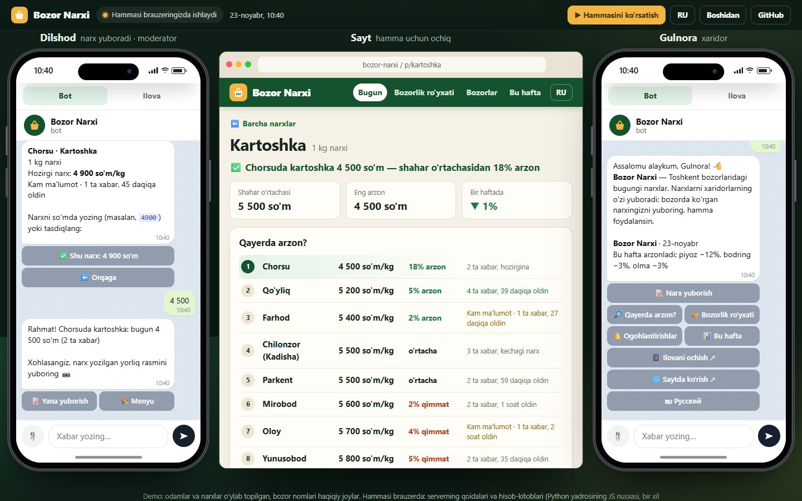

# Bozor Narxi

[English](README.md) · **O'zbekcha**

[](https://github.com/xoliddev/bozor-narxi/actions/workflows/ci.yml)
[](https://xoliddev.github.io/bozor-narxi/)
[](LICENSE)

**Toshkent bozorlaridagi narxlar — xaridorlarning o'zidan.** Telegram botga har kim bozorda ko'rgan narxni yuboradi:
Chorsu, Oloy, Mirobod, Yunusobod, Qo'yliq, Farhod, Chilonzor (Kadisha), Parkent. **Ochiq sayt** esa hammaga
ko'rsatadi: bugungi narxlar, narx qanday o'zgargani (grafik) va *"qayerda arzon?"*. Telegram ichidagi ilovada
bozorlik ro'yxati va ogohlantirishlar bor.

**Asosiy narsa — ishonch.** Odamlar yuborgan narx bitta noto'g'ri xabar bilan buzilib qolmasligi kerak. Shuning uchun
har bir bozor, mahsulot va kun uchun narx shunday hisoblanadi:

- odatdagi narxdan juda uzoq xabar *shubhali* deb belgilanadi va hisobga kirmaydi;
- qolganlari **vaznli median** bilan birlashtiriladi (o'rtadagi qiymat, ishonchli odamning ovozi og'irroq);
- o'rtachadan haddan tashqari uzoq xabarlar chiqarib tashlanadi;
- har bir odamning "vazni" uning tarixidan: yangi akkaunt kam ta'sir qiladi, narxi doim to'g'ri chiqadigan odamning
  ta'siri oshadi, ko'p adashgan yoki moderator yashirgan xabarlar egasining ta'siri tushadi.

Hammasi butun sonlar bilan hisoblanadi, shuning uchun server (Python) va brauzer (JavaScript) aynan bir xil narxni
ko'rsatadi. Kimdir *"kartoshka 500"* deb yozsa, xabar shubhali bo'ladi, narx o'zgarmaydi, unga esa betaraf javob
ketadi: *"Tekshiruvga yuborildi"*.

**[Jonli demo →](https://xoliddev.github.io/bozor-narxi/)** Dilshodning telefoni (narx yuboradi va moderator),
Gulnoraning telefoni (xaridor) va ochiq sayt yonma-yon, 10 qadamli hikoya bilan. Hammasi brauzeringizda ishlaydi.



## Nimalar bor

- **Narx yuborish (botda, faqat tugmalar):** Bozor → Mahsulot → narxni yozish (*"4 500"*, *"4500 so'm"*,
  *"kartoshka 4500"*) yoki bitta tugma — **"✅ Shu narx"**. Xohlasangiz, narx yorlig'ining rasmi. Bir kishi bir kunda
  bir bozor va mahsulot uchun bitta xabar yuboradi (keyingisi avvalgisini almashtiradi). Bot nima o'zgarganini darhol
  aytadi: *"Rahmat! Chorsuda kartoshka: bugun 4 500 so'm (2 ta xabar)"*.
- **Ishonch belgisi har joyda:** *"5 ta xabar, 40 daqiqa oldin"*, *"Kam ma'lumot · 1 ta xabar"*, *"kechagi narx"*.
- **"Qayerda arzon?"** — har bir mahsulot uchun bugungi narx barcha bozorlarda, arzondan qimmatga; shahar o'rtachasi;
  qancha arzon (% va so'm); bir haftalik o'zgarish ▲/▼; 30 yoki 90 kunlik grafik (shahar o'rtachasi, eng arzon va
  eng qimmat bozor oralig'i, istalgan bozorning o'z chizig'i).
- **Bozorlik ro'yxati:** mahsulot va miqdorni tanlaysiz — har bir bozorda jami qancha bo'lishi, eng arzoni va eng
  qimmatiga nisbatan qancha tejash (*"Oloyda 314 700 so'm — eng qimmatidan 26 500 so'm tejaysiz"*), masofa (joylashuvni
  bersangiz) va qaysi bozorda qaysi mahsulot narxi yo'qligi halol ko'rsatiladi. Sayt, ilova va botda bitta hisob.
- **Ogohlantirish:** *"Piyoz 6 000 so'mdan arzon bo'lsa xabar ber"* — bir marta keladi. Har dushanba ertalab haftalik
  sharh: *"Bu hafta arzonladi: piyoz −12%"*.
- **Moderatsiya:** moderatorga har bir shubhali xabar keladi (qayerda, qancha, odatdagi narx, kim yubordi, uning
  ishonchi) — **🙈 Yashirish** yoki **⛔ Bloklash**. Narx darhol qayta hisoblanadi.
- **Sayt:** bugungi narxlar jadvali (qidiruv, toifalar), mahsulot sahifasi, bozor sahifasi, bozorlik ro'yxati,
  haftalik ko'rinish. Ro'yxatdan o'tish shart emas, telefonda ham qulay. O'zbekcha, bir bosishda ruscha.

Seed'dagi barcha odamlar va narxlar **o'ylab topilgan**; bozor nomlari haqiqiy joylar, ular haqida boshqa hech narsa
da'vo qilinmaydi.

## Qanday ishga tushiriladi

```bash
cp .env.example .env          # BOT_TOKEN — @BotFather'dan, MODERATOR_IDS — o'zingizning Telegram id
pip install -r requirements.txt
python -m bozornarxi
```

Sayt `http://localhost:8080/` da ochiladi. Ilova va botdagi havolalar uchun `PUBLIC_URL` ga HTTPS manzil yozing
(masalan, bepul cloudflared tunnel). Docker bilan:

```bash
docker compose up -d --build
```

## Xavfsizlik

- Ilova har bir so'rovda Telegram imzosini (`initData`) yuboradi, server uni va uning yangiligini tekshiradi.
- Ochiq sayt faqat o'qiydi, so'rovlar soni cheklangan, xabar yuborganlarning ismi hech qachon ko'rinmaydi.
- Har bir narx mahsulotga mos oraliqda tekshiriladi, SQL faqat parametrlar bilan, foydalanuvchi matni har doim
  xavfsiz ko'rsatiladi, qat'iy CSP.
- Konteyner root bo'lmagan foydalanuvchi bilan ishlaydi; kalitlar repoda yo'q (`.env` git'ga kirmaydi).

## Testlar

pytest (yadro, servis, bot, HTTP), node --test (JS nusxa Python bilan bir xilmi, demo hikoyasi 30 kun va Yangi yil
orqali) va Playwright (demo 1440 va 375 px kenglikda, konsolda xato yo'q).

MIT © xoliddev
